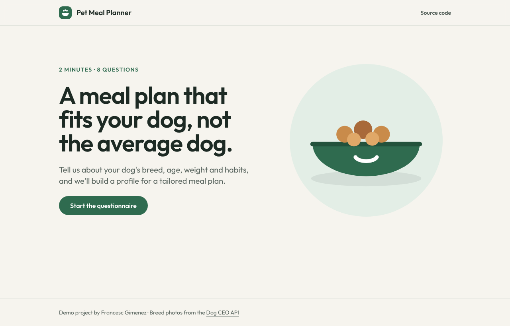
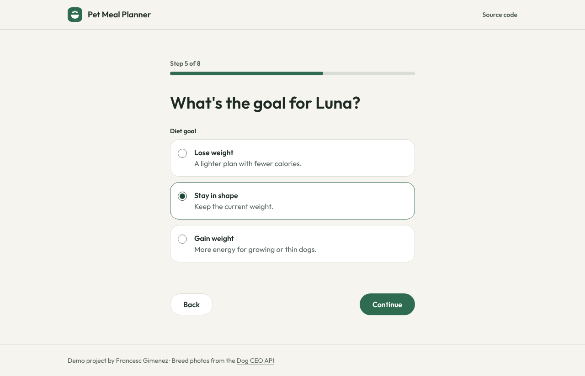
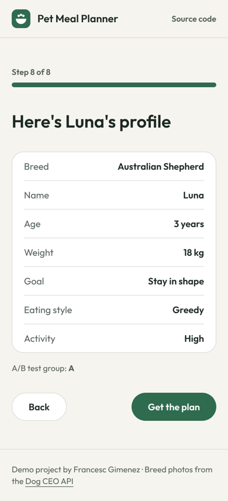

# Pet Meal Planner

A multi-step questionnaire that builds a dog's profile for a tailored meal plan, with a built-in **A/B test**: half of the visitors skip one of the questions, so the team can measure whether a shorter form converts better.

Built with Nuxt 4, Vue 3, TypeScript and Pinia, following a hexagonal (ports and adapters) architecture.

**Live demo:** https://franziskus16.github.io/nuxt-pet-diet-form/



| A question step | Summary on mobile |
| --- | --- |
|  |  |

## Features

- **Eight-step form** with breed, name, age, weight, diet goal, eating style and activity level, then a summary.
- **A/B test.** Each browser is assigned to group A or B once and keeps it. Group B skips the activity question. The assignment, each completed step and the final submission are tracked as analytics events.
- **Analytics ready for Google Tag Manager.** Events are pushed to `window.dataLayer` in the format GTM expects, so they could be sent to GA4 without touching the code.
- **Progress is saved.** Answers live in `localStorage`, so a reload or a closed tab doesn't lose them. Corrupt or outdated saved data is ignored safely.
- **Real breed data** from the public [Dog CEO API](https://dog.ceo/dog-api/), with a photo of the chosen breed and a retry option if the request fails.
- **Validation with clear messages** instead of disabled buttons, and a Back button on every step.
- **Accessible.** Every field has a label, errors are linked to their inputs and announced, choices are real radio groups, focus moves to each new question, there is a skip link and the progress bar is exposed to screen readers.

## Architecture

The business rules don't know about Vue, the browser or the API. Everything external sits behind an interface (a *port*) with a concrete *adapter*, so each part can be swapped or faked in tests.

```
app/
├── domain/form/              # Pure TypeScript, no framework
│   ├── entities.ts           # FormStep, Group, PetProfile, Breed
│   ├── stepFlow.ts           # Which steps each A/B group sees, next/previous/progress
│   ├── validation.ts         # Rules for name, age and weight
│   └── ports.ts              # BreedRepository, AnalyticsTracker, FormStorage
├── infrastructure/           # Adapters for the ports
│   ├── dogCeoBreedRepository.ts
│   ├── dataLayerAnalytics.ts
│   ├── localFormStorage.ts
│   └── dependencies.ts       # Wires the adapters (and lets tests replace them)
├── stores/form.ts            # Pinia store: the application layer the UI talks to
├── components/
│   ├── base/                 # BaseButton, BaseInput, BaseSelect, BaseChoiceGroup
│   ├── common/               # AppHeader, ProgressBar
│   └── form/                 # StepShell, FormRenderer and one component per step
├── pages/                    # / and /form
└── utils/designTokens.ts     # Colours, font and radii, used by Tailwind
```

## Tests

- **Unit tests (Vitest, 30 tests):** step flow per group, validation, the store (group assignment, persistence, back navigation, submission), the adapters, and the step components including error and retry states.
- **End-to-end tests (Playwright, desktop and mobile):** the full journey for group A and group B, validation errors, and progress surviving a reload. They run against the production build, with the Dog API mocked so they never depend on the network.

## Running it

Requires Node 20.19 or newer.

```bash
npm install
npm run dev          # http://localhost:3000
npm run test:ci      # unit tests
npm run test:e2e     # end-to-end tests (builds the site first)
npm run generate     # static build in .output/public
```

To check the A/B test, open the browser console, clear `localStorage` and reload: you'll get a new random group and an `ab_group_assigned` event in `window.dataLayer`.

## Deployment

Every push to `main` runs type checking, unit tests and end-to-end tests in GitHub Actions, then publishes the static build to GitHub Pages.
